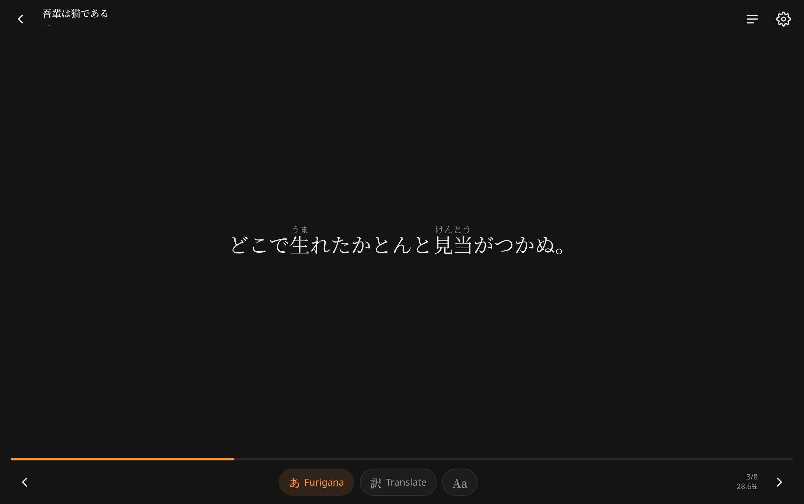
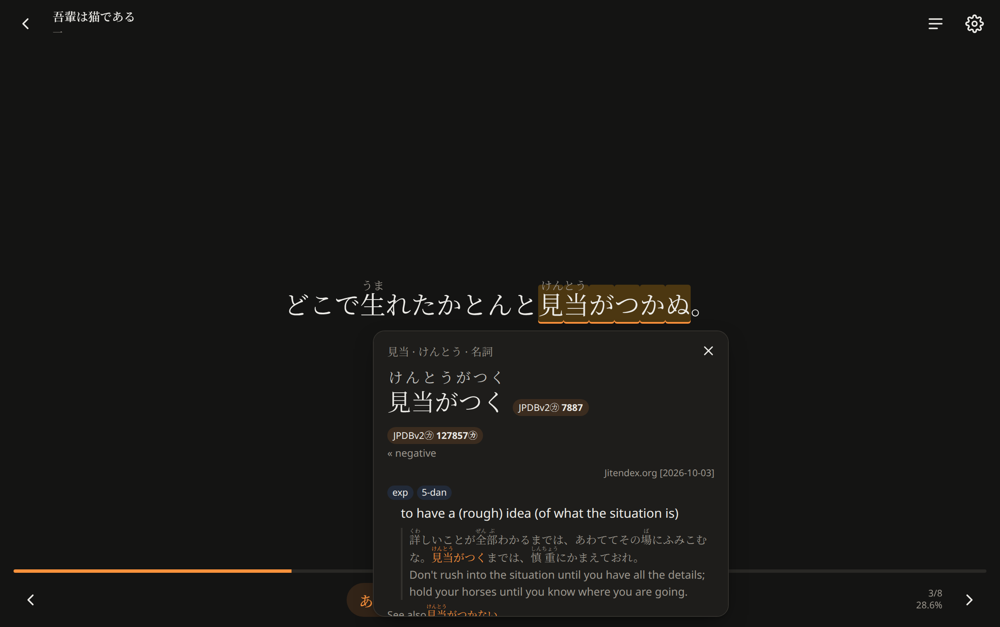
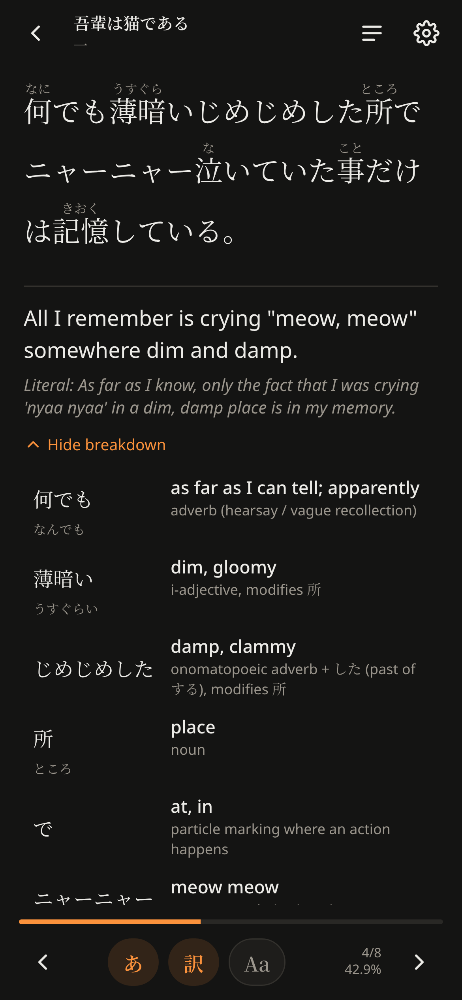
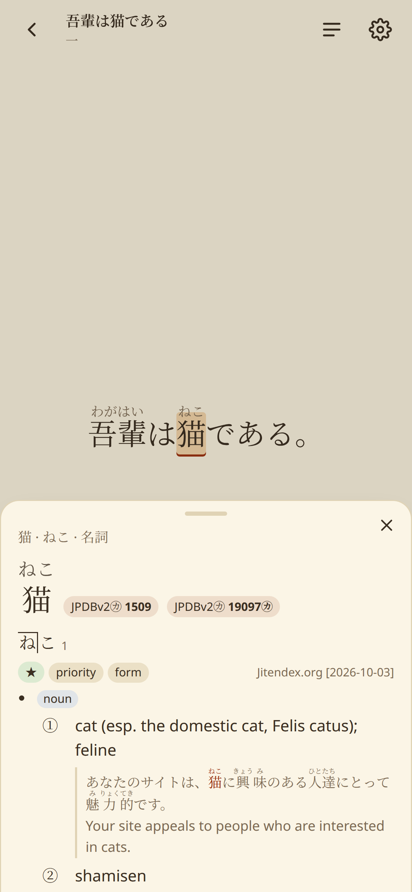
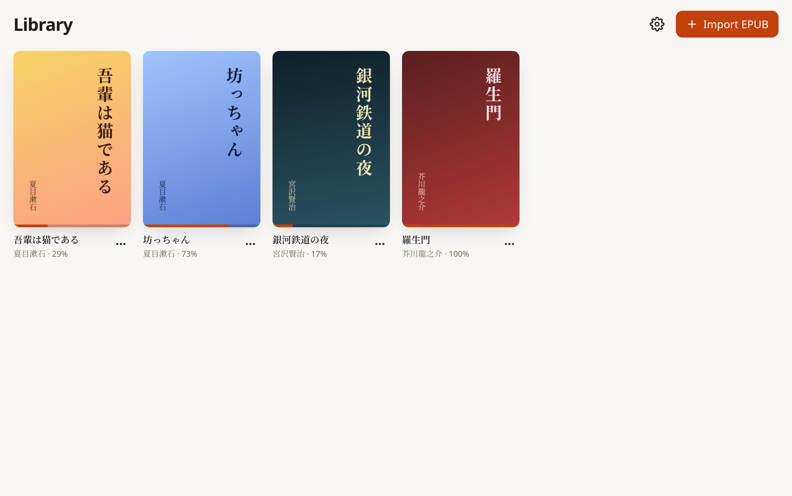
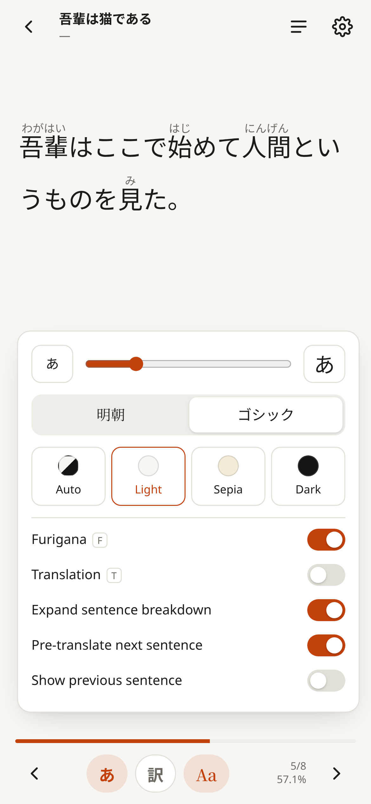

# Yomu — sentence-by-sentence Japanese light novel reader

Read Japanese EPUB light novels **one sentence at a time**, with furigana, built-in
Yomitan-style dictionary lookups, and on-demand LLM translations that explain each sentence.

Runs on **Linux** and **Android** (primary targets), plus Windows, macOS and iOS (Tauri 2).

**Download:** [latest release](https://github.com/KanarekLife/yomu/releases/latest): AppImage, .deb and .rpm for Linux, an installer for Windows, and an APK for Android.

<p align="center">
  
</p>

| Dictionary lookup | Translation and breakdown | On a phone |
|---|---|---|
|  |  |  |

| Library | Quick reading options |
|---|---|
|  |  |

<sub>Screenshots use public-domain texts (夏目漱石『吾輩は猫である』) and the real Jitendex, JPDB and Kanjium dictionaries. To regenerate them, see [`scripts/screenshots`](scripts/screenshots/capture.mjs).</sub>

## Features

- **EPUB import** (EPUB 2 and 3, Calibre/Sigil output). The book's own `<ruby>` furigana is kept and preferred.
- **Illustrations** appear where they are in the book, as a step of their own; tap one to view it full screen, or turn them off in `Aa`.
- **One sentence at a time**, centred. Animated transitions between sentences; dialogue in 「…」 is split sensibly.
- **Quick reading controls** in the reader: `あ Furigana` and `訳 Translate` pills, plus an `Aa` panel for text size, font, theme and translation options.
- **Toggleable furigana** (`F`), generated by the lindera tokenizer with embedded IPADIC. Fully offline.
- **Dictionary lookup**: tap a word. Uses Yomitan-format dictionaries (Jitendex, JMdict, frequency lists, pitch accent), with deinflection (`走らされてしまった → 走る`), frequency badges, pitch graphs, and structured-content glossaries.
- **Translation and breakdown** (`T`) from any OpenAI-compatible API: DeepSeek (`deepseek-flash`), OpenAI, OpenRouter, Ollama, LM Studio, and others. Each result has a natural translation, a literal rendering, a word-by-word breakdown (reading, meaning, grammatical role) and grammar notes. Results are cached per sentence, and the next sentence is prefetched.
- **Sync between devices** (Settings → Sync): your library including the EPUB files, reading positions, settings and cached translations. Use a small self-hosted [Yomu server](#sync-server) or any synced folder (Syncthing, Nextcloud…).
- **Progress bar** that can be scrubbed, with a chapter preview; a table of contents; position is saved automatically.
- Light, sepia and dark themes; Mincho or Gothic font; adjustable size; respects reduced-motion settings.

Keys: `←/→`, `Space`, `PageUp/PageDown` to navigate · `F` furigana · `T` translation · `Esc` close.
Touch: swipe left or right to move between sentences; tap a word to look it up.

## First steps

1. **Import a book**: Library → *Import EPUB*. On desktop you can also drag and drop files.
2. **Add dictionaries**: tap any word and press *Install recommended*. This is one click and downloads about 50 MB:
   Jitendex, JPDB frequency and Kanjium pitch accents. Under Settings → Dictionaries → *More dictionaries and custom sources*
   you can add JMdict or BCCWJ, install any Yomitan `.zip` from a URL or a file, and reorder or disable dictionaries.
3. **Set up translation**: Settings → Translation. Pick a preset (DeepSeek by default:
   base URL `https://api.deepseek.com`, model `deepseek-flash`), paste your API key, and press *Test connection*.
   Under *Advanced* you can set the context size, temperature, JSON mode, extra request JSON
   (e.g. vendor flags), and custom instructions.

## Sync server

`crates/yomu-server` is a small server (Rust, PostgreSQL) with accounts, device tokens and an admin panel at `/admin`.
The image is `ghcr.io/kanareklife/yomu-server:main`:

```sh
podman run -p 8080:8080 \
  -e DATABASE_URL=postgres://yomu:secret@db:5432/yomu \
  -e YOMU_ADMIN_USER=admin -e YOMU_ADMIN_PASSWORD=change-me \
  ghcr.io/kanareklife/yomu-server:main
```

| Variable | |
| --- | --- |
| `DATABASE_URL` | PostgreSQL URL (required; `sslmode` honoured) |
| `YOMU_LISTEN` | listen address, default `0.0.0.0:8080` |
| `YOMU_MAX_FILE_MB` | EPUB upload limit, default `200` |
| `YOMU_PUBLIC_URL` | external URL, e.g. `https://yomu.example.com` (needed for SSO) |
| `YOMU_OIDC_ISSUER`, `YOMU_OIDC_CLIENT_ID`, `YOMU_OIDC_CLIENT_SECRET` | panel sign-in via OpenID Connect; redirect URI is `$YOMU_PUBLIC_URL/admin/oidc/callback` |
| `YOMU_OIDC_ADMIN_GROUP` | optional: require this group in the `groups` claim |
| `YOMU_ADMIN_USER`, `YOMU_ADMIN_PASSWORD` | local break-glass panel login |
| `YOMU_ADMIN_LOCAL` | `true`/`false`; default `true` when a password is set |

Panel admins are not app accounts and app accounts cannot open the panel.
Create accounts in `/admin` (including one for yourself), then in the app open Settings → Sync → *Yomu server* and sign in.
Without a server, choose *Folder* and point every device at a folder that Syncthing keeps in sync (ADR-0016).

## Development

Requirements: Rust (stable), Node 22+, **pnpm** (pinned in `package.json`), and the
[Tauri prerequisites](https://v2.tauri.app/start/prerequisites/) for your OS.
`mise.toml` pins the toolchain (`mise install`).

JavaScript dependencies are installed through [Aikido Safe Chain](https://github.com/AikidoSec/safe-chain),
which blocks known-malicious packages and versions published less than 48 hours ago (ADR-0013).
Install it once, then restart your terminal:

```sh
curl -fsSL https://github.com/AikidoSec/safe-chain/releases/download/1.5.27/install-safe-chain.sh -o /tmp/isc.sh \
  && echo "600ebddcb3aaf1fd53653a8d7985df44528722c0f5ee7eb9fff86f26a1a4e5a8  /tmp/isc.sh" | sha256sum -c - && sh /tmp/isc.sh
pnpm safe-chain-verify                    # → OK: Safe-chain works!
```

```sh
pnpm install
pnpm tauri dev                            # desktop dev build with hot reload
cargo test -p reader-core                 # core unit tests (no GUI deps needed)
cargo run -p reader-core --release --example inspect_epub -- book.epub 40   # inspect segmentation and furigana
pnpm check                                # Svelte/TypeScript checks
```

Screenshots (headless Chromium, real UI with fixtures from the real core):

```sh
cargo run -p reader-core --release --example screenshot_fixtures -- scripts/screenshots/fixtures.json
pnpm build && pnpx playwright install chromium && pnpm screenshots   # → docs/screenshots/
```

### Reproducible builds (podman, no host packages needed)

Useful on immutable distros (Fedora Silverblue or Kinoite):

```sh
build/linux.sh                # AppImage, .rpm and .deb → target-container/release/bundle/
build/android.sh --debug      # APK → src-tauri/gen/android/app/build/outputs/apk/
```

Releases are built by GitHub Actions (`.github/workflows/release.yml`) when you push a `v*` tag.
Android release signing reads the `ANDROID_KEYSTORE_BASE64`, `ANDROID_KEY_ALIAS` and
`ANDROID_KEY_PASSWORD` repository secrets.
iOS builds need macOS with Xcode: `pnpm tauri ios init && pnpm tauri ios build`.

## Layout

```
crates/reader-core/   platform-independent core (Rust): EPUB, segmentation, tokenizer, deinflection,
                      Yomitan dictionaries, SQLite storage, LLM client; unit tested
src-tauri/            thin Tauri shell: commands, file pickers, events
src/                  Svelte 5 UI (Library, Reader, Settings; lookup popup; translation panel)
docs/adr/             Architecture Decision Records: start here
build/                container definitions and build scripts
```

## Architecture decisions

The work is organised by ADRs in [`docs/adr`](docs/adr/README.md). Each records the
context, the decision, its consequences and follow-ups. Add a new ADR (copy `0000-template.md`)
before making a significant architectural change.
